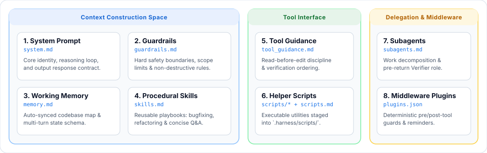

<h3 align="center">
  <br>
  Autonomous Agent Harnessing &amp; Continuous Self-Healing Loop
</h3>

<p align="center">
  <a href="https://github.com/pritampanda15/autoharness/actions/workflows/ci.yml"></a>
  <a href="#mcp-agent-server--universal-plugin-installation"></a>
  <a href="#flat-rate-subscriptions-0-api--open-source-models"></a>
  <a href="docs/ARCHITECTURE.md"></a>
  <a href="pyproject.toml"></a>
  <a href="LICENSE"></a>
</p>

<p align="center">
  <a href="#install">
    
  </a>
</p>

A **harness** is the software system around a model that enables it to act as a reliable agent: prompts, guardrails, memory, skills, tool guidance, scripts, subagents, and runtime middleware. **Harness engineering** is the discipline of designing, evaluating, and optimizing that system.

**AutoHarness** is a plug-and-play framework, **MCP agent server**, and **universal IDE/CLI plugin** for **autonomous agent harnessing and continuous self-healing** inspired by [Google Research's Harness²](https://github.com/google-research/harness2). Rather than relying on manual trace inspection or prompt babysitting whenever new or legacy code changes, AutoHarness connects **autonomous code healing** with **two levels of harness recursion** while keeping model weights fixed:

* **Task & code-level recursion** scans newly written and existing code (`AST` + imports + `pytest`), repairs failing modules inside isolated sandboxes (with byte-for-byte SHA-256 test protection), and refines the active harness via a contrastive **Propose–Probe–Compose** step — keeping an edit only when **hidden holdout cases** and cost gates agree it helped.
* **Harnessing-level recursion** updates a persistent *Lesson Ledger* (`lessons/lessons.json` & `LESSONS.md`) and live codebase memory (`memory.md`) with empirically validated `DO` and `AVOID` priors to guide future sessions.

<p align="center">
  <a href="assets/autoharness_pipeline.svg">
    
  </a>
</p>

Evaluations run cheapest-first — **deterministic checks → behavioral trace checks → evidence-grounded autonomous judge** — so objective checks cost zero tokens and unanimous, artifact-grounded verdicts auto-certify without waiting on manual human lookup.

AutoHarness works across **any AI model or billing setup**:
- **Flat-rate AI subscriptions (`$0.00` pay-per-token API cost):** Claude Pro / Max / Team (`claude`), ChatGPT Plus / Pro / Team (`codex`), Google AI Pro / Ultra (`gemini`), and GitHub Copilot Pro (`copilot`) — with automatic API-key isolation so CLI runs never trigger metered API charges.
- **100% local & self-hosted open-source models (`$0.00`):** Ollama (`qwen2.5-coder`, `deepseek-r1`, `llama3.3`, `gemma3`), vLLM, LM Studio, `llama.cpp`, and OpenRouter.
- **MCP Agent Server & 1-Click Universal Plugin:** Install into **Google Antigravity**, **Claude Code / Desktop**, **Cursor**, **VS Code Copilot**, **Gemini CLI**, **OpenAI Codex CLI**, **Windsurf**, **Cline**, or **Zed** so your host AI assistant drives write-locked repairs using its own active session.
- **AutoHarness Studio & One-Click `Auto-Fix`:** Interactive visual workbench (`autoharness studio`) with 60fps telemetry motion graphics, an orbiting 3D 8-component Harness² topology, and instant one-click repair on any failing test or module.

## Contents

- [Harness components](#harness-components)
- [Install](#install)
- [Continuous self-healing loop](#continuous-self-healing-loop)
- [AutoHarness Studio & One-Click Auto-Fix](#AutoHarness-studio--one-click-auto-fix)
- [Flat-rate subscriptions (`$0` API) & open-source models](#flat-rate-subscriptions-0-api--open-source-models)
- [MCP Agent Server & universal plugin installation](#mcp-agent-server--universal-plugin-installation)
- [Experiments and recursion modes](#experiments-and-recursion-modes)
- [Layered grading and autonomous certification](#layered-grading-and-autonomous-certification)
- [Safety and anti-gaming guardrails](#safety-and-anti-gaming-guardrails)
- [Results, reports, and calibration](#results-reports-and-calibration)
- [Citation](#citation)
- [Contributing](#contributing)
- [License](#license)

## Harness components

AutoHarness exposes eight editable components around the frozen model: **system prompt, guardrails, working memory, procedural skills, tool guidance, helper scripts, subagents, and middleware plugins**. Together they govern context construction, the tool interface, work delegation, and deterministic behavior inside the tool loop.

<p align="center">
  <a href="assets/components.svg">
    
  </a>
</p>

Single-file harnesses (`harnesses/claude-code/system.md`) work out of the box; scaffold or inspect a full 8-component directory anytime with `autoharness tree --init harnesses/harness2`.

## Install

Use **Python 3.10+** (with [`uv`](https://docs.astral.sh/uv/) or `pip`). From the repository root:

```bash
git clone https://github.com/pritampanda15/autoharness.git
cd autoharness
pip install -e '.[dev]'
autoharness demo
```

The local demo runs completely offline with no API keys required: it repairs a buggy Python module in an isolated sandbox, executes a 3-candidate **Propose–Probe–Compose** harness step with real sandboxed checks, blocks overfitting and holdout regressions, and writes the HTML report and lesson ledger in ~2 seconds.

For live runs on any repository, pick whichever mode fits your setup:
- **Flat-rate subscription (`$0` API billing):** `autoharness models --use subscription-pool` (or `claude-sub`, `codex-sub`, `gemini-sub`, `copilot-sub`).
- **Local open-source (`$0`):** `autoharness models --use ollama-qwen` or `autoharness models --use vllm-local`.
- **Host AI Agent / IDE Plugin (`$0` extra keys):** `autoharness plugin install --target all` to expose AutoHarness via MCP + Agent Skills.
- **Pay-per-token API keys (optional):** Set `ANTHROPIC_API_KEY`, `OPENAI_API_KEY`, `GEMINI_API_KEY`, or `OPENROUTER_API_KEY`.

See the [configuration reference](docs/CONFIG.md) for substrate settings and budget controls.

## Continuous self-healing loop

Initialize or onboard any existing repository, synthesize evaluation cases from your code, open the visual Studio, and leave the closed loop watching both your source code (`code_paths`) and your harness:

```bash
autoharness init my-project && cd my-project
autoharness synthesize src/             # auto-generate dev + hidden holdout YAML cases from Python modules
autoharness run --autonomous --open     # run 3-layer suite & establish regression baseline
autoharness studio                      # launch the autoharness Studio + 1-Click Auto-Fix
autoharness watch --now                 # continuous loop: heal -> run -> gate -> contrastive fix
```

Every time new or legacy code (or a harness file) is saved or committed, AutoHarness verifies and heals automatically:

```bash
# One-shot autonomous code repair + memory.md sync + harness regression gate
autoharness heal src/ --with-harness

# Enforce automatically on every Git commit
autoharness hook install --kind pre-commit
```

| Workflow | Command | Highlights |
|---|---|---|
| Autoharness Studio | `autoharness studio [--port 8484] [--export studio.html]` | 60fps telemetry, 3D Harness² sphere, 1-click `Auto-Fix`, Model & MCP Hub |
| Universal Model & Sub Switcher | `autoharness models [--use PRESET]` | Subscriptions (`$0` API), Codex, Gemini, Copilot, Ollama, vLLM, Claude |
| MCP Agent Server | `autoharness mcp [--root DIR]` | Zero-dependency JSON-RPC 2.0 stdio server with 9 tools & 2 resources |
| Universal Plugin Installer | `autoharness plugin {install,status} [--target TARGET]` | Antigravity, Claude Code, Cursor, VS Code Copilot, Gemini CLI, Codex CLI |
| Code Self-Healing | `autoharness heal [PATHS...] [--changed] [--with-harness]` | Isolated sandbox AST/import/`pytest` repair with SHA-256 locked tests |
| Auto-Case Synthesis | `autoharness synthesize [PATHS...]` | Emits `dev` + hidden `holdout` YAML cases into `cases/auto/` |
| Continuous Watcher & Hooks | `autoharness watch [--now]` / `autoharness hook install` | File-watcher daemon & Git `pre-commit` / `pre-push` enforcement |
| Session Failure Mining | `autoharness mine` / `autoharness auto` | Drafts regression cases from real coding-agent transcripts |

`ah` is installed as a short alias for `autoharness`.

## AutoHarness Studio & One-Click `Auto-Fix`

Launch `autoharness studio` (or export a standalone zero-CDN snapshot via `autoharness studio --export studio.html`) to inspect and control the entire closed loop visually:

- **Immediate One-Click `Auto-Fix`:** Whenever any unit test, import, or evaluation case fails, a prominent **`Auto-Fix`** action appears in the floating top dock, overview alert banner, Code Healer matrix, Trace Inspector, and standalone HTML run reports (`runs/<id>/report.html`). Clicking it heals broken Python modules in isolated sandboxes (with tests write-locked), runs contrastive **Propose–Probe–Compose** on failing dev cases, gates against hidden holdout cases, updates `memory.md` and `lessons.json`, and refreshes pass rates live.
- **6 Interactive Panes + 60fps Motion Graphics:**
  1. **Overview & Quality Gate** — Sweeping radial gauges, real-time 60fps closed-loop signal stream canvas, cubic-spline pass trajectory, and 3-layer grading waterfall.
  2. **8-Component Harness² Tree** — Interactive 3D refractive glass orbital sphere + live Markdown/JSON component editor and prompt compiler.
  3. **Code Self-Healer** — Per-module AST, package import, and `pytest` verification matrix with locked-test badges and per-module `Auto-Fix`.
  4. **Probe Arena** — Live 3-track **Propose–Probe–Compose** sandbox race canvas and dual-bar (`dev` vs. `holdout`) candidate ledger.
  5. **Runs & Trace Inspector** — Filterable trial transcripts, tool-call timelines, and inline forensic `Auto-Fix`.
  6. **Lessons & Continuous Loop** — Empirical `DO` / `AVOID` priors and 1-click Git `pre-commit` / `post-commit` hook toggles.

## Flat-rate subscriptions (`$0` API) & open-source models

CLI coding agents (`claude`, `codex`, `gemini`, `copilot`) support flat-rate OAuth logins, **unless** `ANTHROPIC_API_KEY`, `OPENAI_API_KEY`, `GEMINI_API_KEY`, or `GOOGLE_API_KEY` happen to exist in your shell environment — in which case those CLIs silently override OAuth and bill pay-per-token API credits.

When `auth_mode: subscription` is active, AutoHarness **automatically strips pay-per-token API keys** inside both trial sandboxes and Fixer/Judge subprocesses, guaranteeing `$0.00` marginal API charges:

```bash
# Inspect detected OAuth subscriptions, local OSS servers, and presets
autoharness models

# Switch your project to any subscription or local open-source model
autoharness models --use subscription-pool   # rotates across active subscriptions + local Ollama on cooldowns
autoharness models --use claude-sub          # Claude Pro / Max / Team (claude login)
autoharness models --use codex-sub           # ChatGPT Plus / Pro / Team (codex login)
autoharness models --use gemini-sub          # Google AI Pro / Ultra (gemini OAuth)
autoharness models --use copilot-sub         # GitHub Copilot Pro / Pro+ (gh auth login + copilot)
autoharness models --use ollama-qwen         # 100% local Qwen 2.5 Coder via Ollama (:11434)
autoharness models --use ollama-deepseek     # 100% local DeepSeek-R1 via Ollama (<think> stripping + XML/JSON tools)
autoharness models --use vllm-local          # Self-hosted vLLM (:8000/v1), LM Studio (:1234/v1), or llama.cpp
```

| Preset ID | Plan / Runtime | Billing | Auth / Endpoint |
|---|---|---|---|
| `subscription-pool` | Multi-Subscription + Local OSS Router | **`$0` API** | Auto-failover across logged-in CLIs & Ollama |
| `claude-sub` | Claude Pro / Max / Team | **`$0` API** | `claude login` (`claude.ai` OAuth, keys isolated) |
| `codex-sub` | ChatGPT Plus / Pro / Team | **`$0` API** | `codex login` (`~/.codex/auth.json` OAuth) |
| `gemini-sub` | Google AI Pro / Ultra | **`$0` API** | `gemini` OAuth (`~/.gemini/oauth_creds.json`) |
| `copilot-sub` | GitHub Copilot Pro / Pro+ | **`$0` API** | `gh auth login` + `copilot -p` CLI |
| `ollama-qwen` / `ollama-deepseek` | Ollama Local Open-Source | **`$0` Local** | `http://127.0.0.1:11434` (`qwen2.5-coder`, `deepseek-r1`, `llama3.3`) |
| `vllm-local` | vLLM / LM Studio / `llama.cpp` | **`$0` Self-Hosted** | OpenAI-compatible `/v1/chat/completions` (`:8000/v1`, `:1234/v1`) |
| `openrouter-oss` | OpenRouter / Direct APIs | Pay-per-token | `OPENROUTER_API_KEY`, `OPENAI_API_KEY`, `GEMINI_API_KEY`, `ANTHROPIC_API_KEY` |

## MCP Agent Server & universal plugin installation

You can also feed AutoHarness directly into **any AI model, IDE, or coding CLI** as a **Model Context Protocol (MCP) server** (`autoharness mcp`) and **Agent Skill plugin** (`autoharness plugin install`). Because your **host AI agent** calls these tools using its own model session, any subscription IDE (Cursor Pro, Claude Code, Antigravity, VS Code Copilot, Windsurf, Cline) gains write-locked self-healing and 8-component Harness² engineering with **zero extra API keys**:

```bash
# Install into ALL 6 agent ecosystems at once:
autoharness plugin install --target all

# Or install into a specific AI assistant / IDE:
autoharness plugin install --target antigravity   # ~/.gemini/config/plugins/autoharness/ (plugin.json + mcp_config.json + SKILL.md)
autoharness plugin install --target claude        # .mcp.json + .claude-plugin/plugin.json + skills/autoharness/SKILL.md
autoharness plugin install --target cursor        # .cursor/mcp.json + .cursor/rules/autoharness.mdc
autoharness plugin install --target vscode        # .vscode/mcp.json (VS Code / GitHub Copilot Agent Mode)
autoharness plugin install --target gemini        # .gemini/settings.json
autoharness plugin install --target codex         # .codex/config.toml

# Check installation status across ecosystems:
autoharness plugin status
```

For any other MCP-compatible client (**Windsurf**, **Cline**, **Zed**, **Continue**, **Claude Desktop**), point its stdio MCP configuration at `autoharness mcp`:

```json
{
  "mcpServers": {
    "autoharness_mcp": {
      "command": "autoharness",
      "args": ["mcp", "--root", "/path/to/your/repo"]
    }
  }
}
```

### Exposed MCP tools & resources (`autoharness_mcp`)

| MCP Tool / Resource | Description |
|---|---|
| `autoharness_snapshot_test_locks` | Captures SHA-256 digests of every `test_*.py` file *before* the host agent edits code |
| `autoharness_scan_code` | Scans Python AST syntax, standalone/package imports, and `pytest`; syncs `memory.md` |
| `autoharness_verify_repair` | **Anti-gaming verifier**: blocks if any locked test SHA-256 changed, then runs AST + `pytest` |
| `autoharness_synthesize_cases` | Generates executable `dev` and hidden `holdout` YAML evaluation cases in `cases/auto/` |
| `autoharness_run_eval` | Executes the 3-layer grading waterfall (`dev`, `holdout`, or `all`) and returns diagnostics |
| `autoharness_autofix` | Runs closed-loop sandbox code repair + contrastive **Propose–Probe–Compose** |
| `autoharness_harness_component` | Lists, reads, writes, or compiles the 8 modular Harness² components |
| `autoharness_lessons` | Reads or records empirical `DO` / `AVOID` engineering priors in `lessons/lessons.json` |
| `autoharness_status` | Returns pass rate, failing cases, active Harness² fingerprint, hooks, and module health |
| `autoharness://harness/compiled` | MCP resource serving the live compiled 8-component Harness² prompt |
| `autoharness://lessons/ledger` | MCP resource serving the structured JSON Lesson Ledger |

## Experiments and recursion modes

Scale task-level harness optimization across two complementary dimensions: **parallel exploration** probes `K` diverse candidate harnesses (spanning *invariant reasoning*, *procedural skills*, and *guardrails*) simultaneously in isolated workspace copies and composes winning behavioral contrasts; **sequential refinement** carries accepted edits and rejected-attempt diagnostics across `max_iters` successive steps.

<p align="center">
  <a href="assets/recursion_modes.svg">
    
  </a>
</p>
<p align="center"><em>Parallel probing explores wider contrasts; sequential iterations refine deeper.</em></p>

| Option / Config | Behavior |
|---|---|
| `fixer.candidates: K` | Propose `K` diverse candidate edits per step (invariant, skill, guardrail) |
| `fixer.parallel: K` | Evaluate candidate probes concurrently in isolated temporary workspaces |
| `fixer.compose: true` | Synthesize one merged candidate from measured per-case probe contrasts |
| `fixer.max_iters: N` | Run up to `N` sequential Propose–Probe–Compose steps (`--max-iters N`) |
| `agent.auth_mode: subscription` | Strip pay-per-token API keys so CLI substrates strictly use flat-rate OAuth logins |
| `--agent {auto,codex,gemini,gemini-cli,copilot,ollama,vllm,lmstudio,openrouter,openai,claude,command,scripted}` | Override execution substrate on any `run`, `heal`, or `auto` invocation |

## Layered grading and autonomous certification

Checks execute cheapest-and-most-certain first, skipping LLM judge calls whenever a deterministic or trace check has already failed:

| Layer | Built-in Checks | Token Cost |
|---|---|---|
| **1. Deterministic** | `command` (`pytest`), `python_syntax`, `imports_clean`, `workspace_integrity`, `file_unchanged`, `json_valid`, regex | **0 (exact)** |
| **2. Behavioral Trace** | `read_before_write`, `verified_after_edit`, `no_loops`, `must_not_call_tool`, `max_turns`, `max_tokens` | **0 (exact)** |
| **3. Grounded Judge** | Multi-sample rubric voting (`samples: 3`) + **Autonomous Evidence Grounding** (`--autonomous`) | **`$0` on Sub / Local OSS** (or Paid API) |

In `--autonomous` mode (`judge.autonomous: true`), an evidence-grounding verifier checks workspace AST/JSON/YAML validity, trace error recovery, and whether cited rubric evidence matches real workspace artifacts — auto-certifying unanimous, grounded runs with zero manual intervention. For human-in-the-loop auditing, `autoharness review` and `autoharness calibrate` track exact agreement and **Cohen's κ**.

## Safety and anti-gaming guardrails

An autonomous self-healing loop must never pass checks by gaming the evaluation:

- **Write-protected tests & evals:** Both sandbox code healing and the `autoharness_verify_repair` MCP gate snapshot SHA-256 hashes of all test files (`test_*.py`, `tests/**`) beforehand and reject any repair that alters or deletes a test. Harness fixing can only write paths listed in `fixer.editable`.
- **Hidden holdout cases:** Cases marked `split: holdout` are never exposed to `propose()` or `compose()`, yet any holdout regression rejects the candidate immediately.
- **Static leak filter:** Candidate edits pasting case IDs, filenames, or literal expected answers into the harness are blocked before any probe runs.
- **Isolated sandboxes & atomic promotion:** Probes execute in throwaway workspace copies; real files are updated only when a candidate clears every gate (`max_token_increase_pct`, `max_growth_pct`, `max_usd_per_trigger`).

Shell commands inside trials run in temporary directories with your OS user permissions; run untrusted third-party cases inside a container.

## Results, reports, and calibration

Artifacts are stored under `runs/`, including `BASELINE`, `fixlog.md` (with unified diffs for every accepted and rejected candidate), per-trial JSON traces, baseline diffs (`diff.json`), and self-contained HTML reports (`autoharness report --open`) featuring inline `Auto-Fix`.

Inspect learned priors anytime with `autoharness lessons`, compare runs with `autoharness diff`, or explore all flags via `autoharness <cmd> --help`.

## Citation

If you build on AutoHarness or recursive agent harnessing in your research or engineering workflows, please cite AutoHarness alongside the foundational Harness² paper:

```bibtex
@software{panda2026autoharness,
  title   = {AutoHarness: Autonomous Agent Harnessing and Continuous Self-Healing Loop},
  author  = {Panda, Pritam},
  year    = {2026},
  url     = {https://github.com/pritampanda15/autoharness}
}

@article{xu2026harness2,
  title   = {Harness$^2$: Recursive Agent Harnessing for an Open World},
  author  = {Xu, Ruiyao and Chen, Yanfei and CuiZhu, Zhongying and Dalvi Mishra, Bhavana and Ming, Yifei and Yu, Han and Han, Rujun and Lee, Chen-Yu and Pfister, Tomas},
  journal = {arXiv preprint arXiv:2610.14224},
  year    = {2026},
  url     = {https://arxiv.org/abs/2610.14224}
}
```

## Contributing

See [CONTRIBUTING.md](CONTRIBUTING.md).

## License

AutoHarness is licensed under [Apache 2.0](LICENSE). © 2026 [pritampanda15](https://github.com/pritampanda15) (<pritampkp15@gmail.com>).
