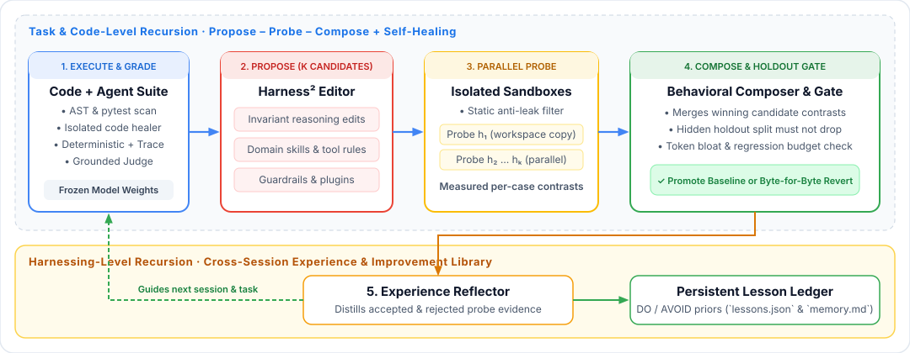
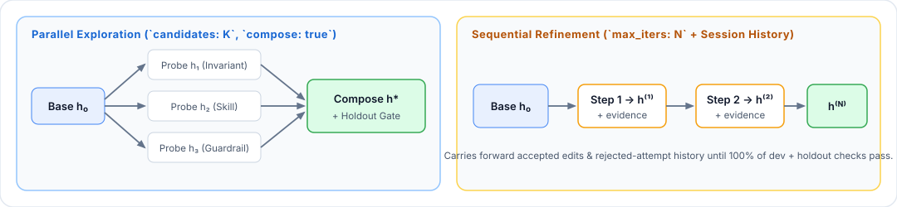

<h3 align="center">
  <br>
  Autonomous Agent Harnessing &amp; Continuous Self-Healing Loop
</h3>

<p align="center">
  <a href="https://github.com/pritampanda15/autoharness/actions/workflows/ci.yml"></a>
  <a href="docs/ARCHITECTURE.md"></a>
  <a href="pyproject.toml"></a>
  <a href="LICENSE"></a>
</p>

<p align="center">
  <a href="#install">
    
  </a>
</p>

A **harness** is the software system around a model that enables it to act as a reliable agent: prompts, guardrails, memory, skills, tool guidance, scripts, subagents, and runtime middleware. **Harness engineering** is the discipline of designing, evaluating, and optimizing that system.

**AutoHarness** is a plug-and-play framework for **autonomous agent harnessing and continuous self-healing** inspired by [Google Research's Harness²](https://github.com/google-research/harness2). Rather than relying on manual trace inspection or prompt babysitting whenever new or legacy code changes, AutoHarness connects **autonomous code healing** with **two levels of harness recursion** while keeping model weights fixed:

* **Task & code-level recursion** scans newly written and existing code (`AST` + imports + `pytest`), repairs failing modules inside isolated sandboxes (with byte-for-byte test protection), and refines the active harness via a contrastive **Propose–Probe–Compose** step — keeping an edit only when **hidden holdout cases** and cost gates agree it helped.
* **Harnessing-level recursion** updates a persistent *Lesson Ledger* (`lessons/lessons.json` & `LESSONS.md`) and live codebase memory (`memory.md`) with empirically validated `DO` and `AVOID` priors to guide future sessions.

<p align="center">
  <a href="assets/autoharness_pipeline.svg">
    
  </a>
</p>

Evaluations run cheapest-first — **deterministic checks → behavioral trace checks → evidence-grounded autonomous judge** — so objective checks cost zero tokens and unanimous, artifact-grounded verdicts auto-certify without waiting on manual human lookup.

The release supports **parallel and sequential recursion**, **8-component Harness² trees and single-file prompts**, **Claude Code, Anthropic, Gemini, and OpenAI/Ollama substrates**, and **continuous file-watching and Git commit hooks**.

## Contents

- [Harness components](#harness-components)
- [Install](#install)
- [Continuous self-healing loop](#continuous-self-healing-loop)
- [Experiments and recursion modes](#experiments-and-recursion-modes)
- [Layered grading and autonomous certification](#layered-grading-and-autonomous-certification)
- [Safety and anti-gaming guardrails](#safety-and-anti-gaming-guardrails)
- [Results, reports, and calibration](#results-reports-and-calibration)
- [Citation](#citation)
- [Contributing](#contributing)
- [License](#license)

## Harness components

AutoHarness exposes eight editable components around the frozen model: **system prompt, guardrails, working memory, procedural skills, tool guidance, helper scripts, subagents, and middleware plugins**. Together they govern context construction, the tool interface, work delegation, and deterministic behavior inside the tool loop.

<p align="center">
  <a href="assets/components.svg">
    
  </a>
</p>

Single-file harnesses (`harnesses/claude-code/system.md`) work out of the box; scaffold or inspect a full 8-component directory anytime with `autoharness tree --init harnesses/harness2`.

## Install

Use **Python 3.10+** (with [`uv`](https://docs.astral.sh/uv/) or `pip`). From the repository root:

```bash
git clone https://github.com/pritampanda15/autoharness.git
cd autoharness
pip install -e '.[dev]'
autoharness demo
```

The local demo runs completely offline with no API keys required: it repairs a buggy Python module in an isolated sandbox, executes a 3-candidate **Propose–Probe–Compose** harness step with real sandboxed checks, blocks overfitting and holdout regressions, and writes the HTML report and lesson ledger in ~2 seconds.

For live runs:
- **Zero API key (default):** Uses your local **Claude Code** login (`autoharness.yaml`) as the agent, judge, and fixer.
- **Direct API substrates:** Set `ANTHROPIC_API_KEY`, `GEMINI_API_KEY`, or `OPENAI_API_KEY` and pass `--config autoharness.api.yaml` (or set `agent.type: gemini | openai | claude`).

See the [configuration reference](docs/CONFIG.md) for substrate settings and budget controls.

## Continuous self-healing loop

Initialize a project, inspect the 8-component Harness² tree, establish your baseline, and leave the closed loop watching both your source code (`code_paths`) and your harness:

```bash
autoharness init my-project && cd my-project
autoharness tree harnesses/harness2
autoharness run --autonomous --open
autoharness studio              # open the interactive Apple-designed AutoHarness Studio UI
autoharness watch --now
```

Every time new or legacy code (or a harness file) is saved or committed, AutoHarness runs automatically:

```bash
# Auto-generate dev & holdout YAML eval cases from existing or newly written Python modules
autoharness synthesize src/

# One-shot autonomous code repair + memory.md sync + harness regression gate
autoharness heal src/ --with-harness

# Or enforce automatically on every Git commit
autoharness hook install --kind pre-commit
```

| Workflow | Command | Guide |
|---|---|---|
| Interactive Visual Studio | `autoharness studio [--port 8484] [--export studio.html]` | [Architecture](docs/ARCHITECTURE.md) |
| Continuous Watcher | `autoharness watch [--now] [--no-fix]` | [Architecture](docs/ARCHITECTURE.md) |
| Code Self-Healing | `autoharness heal [PATHS...] [--changed]` | [Architecture](docs/ARCHITECTURE.md) |
| Auto-Case Synthesis | `autoharness synthesize [PATHS...]` | [Writing Cases](docs/CASES.md) |
| Session Failure Mining | `autoharness mine` / `autoharness auto` | [Writing Cases](docs/CASES.md) |

`ah` is installed as a short alias for `autoharness`.

## Experiments and recursion modes

Scale task-level harness optimization across two complementary dimensions: **parallel exploration** probes `K` diverse candidate harnesses (spanning *invariant reasoning*, *procedural skills*, and *guardrails*) simultaneously in isolated workspace copies and composes winning behavioral contrasts; **sequential refinement** carries accepted edits and rejected-attempt diagnostics across `max_iters` successive steps.

<p align="center">
  <a href="assets/recursion_modes.svg">
    
  </a>
</p>
<p align="center"><em>Parallel probing explores wider contrasts; sequential iterations refine deeper.</em></p>

| Option / Config | Behavior |
|---|---|
| `fixer.candidates: K` | Propose `K` diverse candidate edits per step (invariant, skill, guardrail) |
| `fixer.parallel: K` | Evaluate candidate probes concurrently in isolated temporary workspaces |
| `fixer.compose: true` | Synthesize one merged candidate from measured per-case probe contrasts |
| `fixer.max_iters: N` | Run up to `N` sequential Propose–Probe–Compose steps (`--max-iters N`) |
| `--agent {claude,gemini,openai,command,scripted}` | Select execution substrate on any `run`, `heal`, or `auto` invocation |

## Layered grading and autonomous certification

Checks execute cheapest-and-most-certain first, skipping LLM judge calls whenever a deterministic or trace check has already failed:

| Layer | Built-in Checks | Token Cost |
|---|---|---|
| **1. Deterministic** | `command` (`pytest`), `python_syntax`, `imports_clean`, `workspace_integrity`, `file_unchanged`, `json_valid`, regex | **0 (exact)** |
| **2. Behavioral Trace** | `read_before_write`, `verified_after_edit`, `no_loops`, `must_not_call_tool`, `max_turns`, `max_tokens` | **0 (exact)** |
| **3. Grounded Judge** | Multi-sample rubric voting (`samples: 3`) + **Autonomous Evidence Grounding** (`--autonomous`) | **Paid** |

In `--autonomous` mode (`judge.autonomous: true`), an evidence-grounding verifier checks workspace AST/JSON/YAML validity, trace error recovery, and whether cited rubric evidence matches real workspace artifacts — auto-certifying unanimous, grounded runs with zero manual intervention. For human-in-the-loop auditing, `autoharness review` and `autoharness calibrate` track exact agreement and **Cohen's κ**.

## Safety and anti-gaming guardrails

An autonomous self-healing loop must never pass checks by gaming the evaluation:

- **Write-protected tests & evals:** Code healing snapshots all test files (`test_*.py`, `tests/**`) beforehand and rejects any repair that alters or deletes a test. Harness fixing can only write paths listed in `fixer.editable`.
- **Hidden holdout cases:** Cases marked `split: holdout` are never exposed to `propose()` or `compose()`, yet any holdout regression rejects the candidate immediately.
- **Static leak filter:** Candidate edits pasting case IDs, filenames, or literal expected answers into the harness are blocked before any probe runs.
- **Isolated sandboxes & atomic promotion:** Probes execute in throwaway workspace copies; real files are updated only when a candidate clears every gate (`max_token_increase_pct`, `max_growth_pct`, `max_usd_per_trigger`).

Shell commands inside trials run in temporary directories with your OS user permissions; run untrusted third-party cases inside a container.

## Results, reports, and calibration

Artifacts are stored under `runs/`, including `BASELINE`, `fixlog.md` (with unified diffs for every accepted and rejected candidate), per-trial JSON traces, baseline diffs (`diff.json`), and self-contained light/dark HTML reports (`autoharness report --open`).

Inspect learned priors anytime with `autoharness lessons`, compare runs with `autoharness diff`, or explore all flags via `autoharness <cmd> --help`.

## Citation

If you build on AutoHarness or recursive agent harnessing in your research or engineering workflows, please cite AutoHarness alongside the foundational Harness² paper:

```bibtex
@software{panda2026autoharness,
  title   = {AutoHarness: Autonomous Agent Harnessing and Continuous Self-Healing Loop},
  author  = {Panda, Pritam},
  year    = {2026},
  url     = {https://github.com/pritampanda15/autoharness}
}

@article{xu2026harness2,
  title   = {Harness$^2$: Recursive Agent Harnessing for an Open World},
  author  = {Xu, Ruiyao and Chen, Yanfei and CuiZhu, Zhongying and Dalvi Mishra, Bhavana and Ming, Yifei and Yu, Han and Han, Rujun and Lee, Chen-Yu and Pfister, Tomas},
  journal = {arXiv preprint arXiv:2610.14224},
  year    = {2026},
  url     = {https://arxiv.org/abs/2610.14224}
}
```

## Contributing

See [CONTRIBUTING.md](CONTRIBUTING.md).

## License

AutoHarness is licensed under [Apache 2.0](LICENSE). © 2026 [pritampanda15](https://github.com/pritampanda15) (<pritampkp15@gmail.com>).
